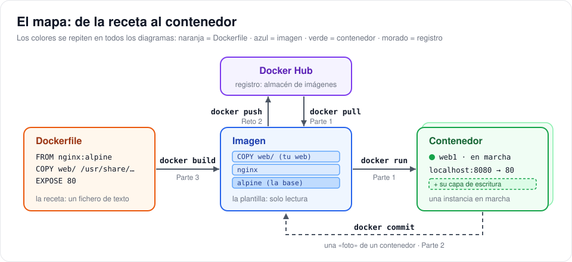
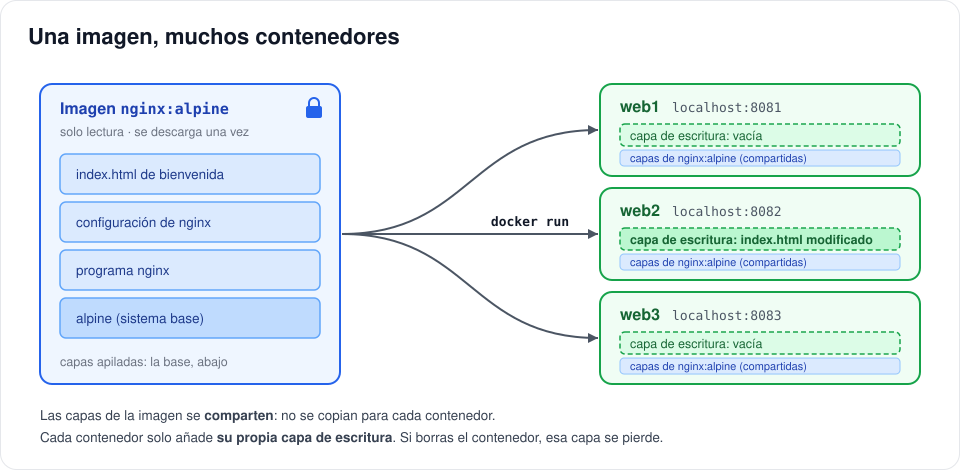
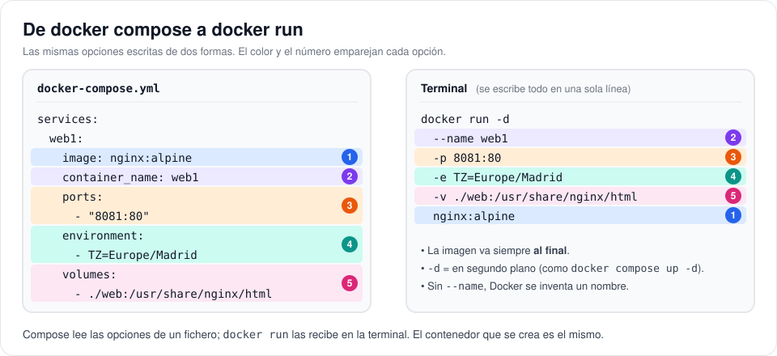
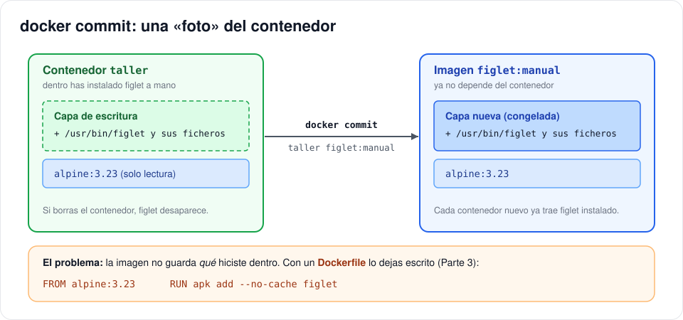
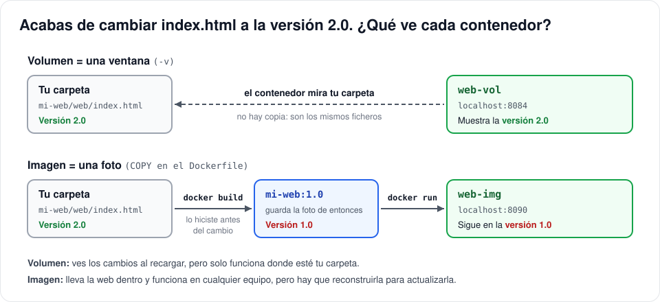

# 🐳 Práctica: crea tus propias imágenes Docker

Hasta ahora has usado imágenes que había hecho otra persona (`nginx`, `mysql`, `wordpress`…) y las has arrancado con `docker compose`. En esta práctica das el paso siguiente: vas a **lanzar contenedores a mano** con `docker run` y a **crear tus propias imágenes** con un `Dockerfile`. En la práctica siguiente meterás aplicaciones de Python y de Node en imágenes y las usarás desde Docker Compose.

Cada parte añade un concepto nuevo y se apoya en la anterior: no te saltes ninguna.

> [!NOTE]
> **Duración:** una sesión de 2 horas.
> **Necesitas:** Docker Desktop en marcha, Git y VS Code. Usa la **terminal de VS Code con PowerShell** (más abajo verás por qué no Git Bash).

**Índice**

- [🎯 Qué vas a aprender](#-qué-vas-a-aprender)
- [🧭 El mapa de la práctica](#-el-mapa-de-la-práctica)
- [🧰 Parte 0 · Prepara tu carpeta](#-parte-0--prepara-tu-carpeta)
- [🚀 Parte 1 · Contenedores a partir de imágenes](#-parte-1--contenedores-a-partir-de-imágenes)
- [📸 Parte 2 · Tu primera imagen, a mano](#-parte-2--tu-primera-imagen-a-mano)
- [📜 Parte 3 · El Dockerfile](#-parte-3--el-dockerfile)
- [⭐ Si te sobra tiempo](#-si-te-sobra-tiempo)
- [📋 Chuleta de comandos](#-chuleta-de-comandos)
- [🩺 Si algo falla](#-si-algo-falla)
- [🧹 Limpieza](#-limpieza)
- [✅ Entrega](#-entrega)
- [✍️ Tus respuestas](#️-tus-respuestas)

---

## 🎯 Qué vas a aprender

| Parte | Qué haces | Qué aprendes |
|---|---|---|
| 0 | Preparas la carpeta de la práctica | El flujo de siempre: clonar → trabajar → publicar |
| 1 | Lanzas contenedores con `docker run` | Qué es una imagen, cómo crear un contenedor con un comando y en qué se diferencia de compose |
| 2 | Creas una imagen «a mano» con `docker commit` | Qué son las capas y por qué necesitamos un Dockerfile |
| 3 | Escribes tus dos primeros Dockerfiles: un programa y una web | `FROM`, `RUN`, `COPY`, `CMD`, `docker build` y la diferencia entre volumen e imagen |
| ⭐ | Conviertes tu imagen en un comando | `ENTRYPOINT` |

Todas las preguntas se responden en la sección [✍️ Tus respuestas](#️-tus-respuestas), al final de este README. Cuando veas **📝**, toca escribir algo allí.

**El plan de la sesión.** Si vas más lento que esto, no te pares a pulir las respuestas: escribe lo justo y sigue.

| Tramo | Tiempo | Llevas… |
|---|---|---|
| Parte 0 · Prepara tu carpeta | 10 min | 0:10 |
| Parte 1 · Contenedores con `docker run` | 40 min | 0:50 |
| Parte 2 · Una imagen a mano con `docker commit` | 15 min | 1:05 |
| 3.1 · figlet con Dockerfile | 15 min | 1:20 |
| 3.2 · Tu web dentro de una imagen | 25 min | 1:45 |
| Commit final y repaso | 15 min | 2:00 |

---

## 🧭 El mapa de la práctica

Este mapa resume toda la práctica. Vuelve a él cada vez que te pierdas.



Solo hay cuatro piezas:

- **Dockerfile** (naranja): un fichero de texto con los pasos para fabricar una imagen.
- **Imagen** (azul): una plantilla con todo lo que necesita un programa para funcionar.
- **Contenedor** (verde): un programa en marcha, creado a partir de una imagen.
- **Registro** (morado): un almacén de imágenes en internet. El más conocido es **Docker Hub**.

Cada vez que hacías `docker compose up`, compose hacía por ti dos flechas del mapa: `pull` y `run`. En esta práctica las haces tú y añades otras dos: `build` y `commit`.

---

## 🧰 Parte 0 · Prepara tu carpeta

### 1. Clona este repositorio dentro de tu repositorio de la asignatura

Abre la carpeta de tu repositorio en VS Code y, en la terminal (PowerShell):

```powershell
git clone https://github.com/CIFPZornotzaLHII/docker-images
cd docker-images
```

### 2. Borra la carpeta `.git` de `docker-images`

Así `docker-images` pasa a formar parte de **tu** repositorio. Si no lo haces, Git lo trata como un repositorio anidado y **su contenido no se subirá a GitHub**.

```powershell
Remove-Item -Recurse -Force .git
```

> [!WARNING]
> Comprueba que estás **dentro de `docker-images`** antes de ejecutarlo. Si lo haces en la raíz, borrarás el historial de **tu** repositorio.

### 3. Mira lo que hay

```text
docker-images/
├── readme.md            ← este enunciado (y tus respuestas, al final)
├── docs/img/            ← los diagramas
└── mi-web/
    └── web/
        └── index.html   ← una web sencilla (Partes 1 y 3)
```

Durante la práctica crearás dos ficheros más: `figlet/Dockerfile` y `mi-web/Dockerfile`.

> [!IMPORTANT]
> A partir de aquí, **todos los comandos se ejecutan desde la carpeta `docker-images`**, salvo cuando el enunciado te diga que entres en otra.

### 4. Publica en GitHub

```powershell
git add --all
git commit -m "Añade la práctica docker-images"
git push
```

---

## 🚀 Parte 1 · Contenedores a partir de imágenes

### 🧠 Conceptos

**Una imagen es una plantilla.** Funciona igual que las plantillas de IsardVDI que usas en clase:

| En IsardVDI | En Docker |
|---|---|
| El profe prepara una **plantilla** con el sistema y los programas instalados | Alguien prepara una **imagen** con el sistema y los programas instalados (`nginx:alpine`) |
| Cada alumno crea **su escritorio** a partir de la plantilla | Tú creas **contenedores** a partir de la imagen (`web1`, `web2`) |
| Lo que cambias en tu escritorio no cambia la plantilla ni el escritorio de tu compañero | Lo que cambias en un contenedor no cambia la imagen ni los otros contenedores |
| Si borras tu escritorio y creas otro, vuelve a estar como la plantilla | Si borras un contenedor y creas otro, vuelve a estar como la imagen |



El diagrama dice lo mismo con las palabras de Docker. Quédate con tres ideas, que vas a comprobar en los ejercicios:

1. **La imagen no cambia nunca.** Es de solo lectura. Está hecha de **capas** apiladas (las verás en la Parte 2).
2. **Cada contenedor guarda sus cambios aparte**, en una capa de escritura propia. Si borras el contenedor, esos cambios se borran con él.
3. **Un contenedor vive mientras vive su programa principal.** Si el programa termina, el contenedor se para.

Las imágenes se llaman **`nombre:etiqueta`**. La etiqueta suele indicar la versión o la variante:

| Imagen | Nombre | Etiqueta |
|---|---|---|
| `mysql:8.0` | `mysql` | `8.0`: la versión |
| `nginx:alpine` | `nginx` | `alpine`: la variante hecha sobre Alpine Linux, un Linux muy pequeño |
| `nginx` | `nginx` | No has puesto ninguna, así que Docker usa `latest` |

### Ejercicio 1.1 · Descarga una imagen

```powershell
docker pull nginx:alpine
docker image ls
```

`pull` descarga la imagen desde Docker Hub. `docker image ls` lista las imágenes que tienes en tu equipo.

📝 **1.1** En `nginx:alpine`, ¿qué es `nginx` y qué es `alpine`? Pega la salida de `docker image ls nginx`.

### Ejercicio 1.2 · Crea un contenedor con un comando

`docker run` crea un contenedor a partir de una imagen y lo arranca. Pruébalo sin ninguna opción:

```powershell
docker run nginx:alpine
```

La terminal se queda «bloqueada» mostrando los mensajes de nginx: el contenedor está en **primer plano**. Pulsa **Ctrl+C** para pararlo y mira qué ha quedado:

```powershell
docker ps        # solo los contenedores en marcha
docker ps -a     # todos, también los parados
```

Así no se puede trabajar: no tiene nombre, no puedes abrirlo en el navegador y te ocupa la terminal. Las opciones de `docker run` lo arreglan, y son las mismas cosas que ya escribías en compose:

```powershell
docker run -d --name web1 -p 8081:80 nginx:alpine
```

| Opción | Qué hace | En compose era… |
|---|---|---|
| `-d` | Lo arranca en **segundo plano** y te devuelve la terminal | El `-d` de `docker compose up -d` |
| `--name web1` | Le pone nombre. Si no, Docker se inventa uno | `container_name: web1` |
| `-p 8081:80` | Publica el puerto: **8081 de tu equipo** → **80 del contenedor** | `ports: - "8081:80"` |
| `nginx:alpine` | La imagen. Va **siempre después** de las opciones | `image: nginx:alpine` |

Abre <http://localhost:8081>: verás la página de bienvenida de nginx. Prueba también:

```powershell
docker ps
docker logs web1     # lo que ha escrito el contenedor
docker stop web1     # lo para (sigue existiendo)
docker ps -a
docker start web1    # lo vuelve a arrancar
```

📝 **1.2** ¿Por qué se quedó «bloqueada» la terminal con el primer `docker run`? ¿Qué nombre le puso Docker a ese contenedor? Pega la salida de `docker ps` con `web1` en marcha.

### Ejercicio 1.3 · Una imagen, muchos contenedores

Crea otro contenedor **a partir de la misma imagen**:

```powershell
docker run -d --name web2 -p 8082:80 nginx:alpine
docker image ls
```

Ahora vas a **entrar** en `web2` y cambiar su página de inicio. `docker exec` ejecuta un comando dentro de un contenedor que ya está en marcha. Con `-it` y `sh` ese comando es una terminal:

```powershell
docker exec -it web2 sh
```

El indicador cambia a `/ #`: **estás dentro del contenedor**. Escribe:

```sh
echo "<h1>Soy web2</h1>" > /usr/share/nginx/html/index.html
exit
```

Abre <http://localhost:8081> y <http://localhost:8082>.

✔️ Solo ha cambiado la página de `web2`. Es la idea 2: el cambio está en la capa de escritura de `web2`, no en la imagen.

Ahora borra `web2` y vuelve a crearlo con el mismo comando:

```powershell
docker rm -f web2
docker run -d --name web2 -p 8082:80 nginx:alpine
```

Recarga <http://localhost:8082>. ¿Sigue diciendo «Soy web2»?

📝 **1.3** Tienes dos contenedores nginx: ¿cuántas imágenes `nginx:alpine` aparecen en `docker image ls`? ¿Por qué solo cambió la página de `web2`? Tras borrarlo y volver a crearlo, ¿sigue tu cambio? ¿Por qué?

> [!IMPORTANT]
> **Conclusión:** lo que cambias *dentro* de un contenedor se pierde al borrarlo. Si quieres que un cambio esté en **todos** los contenedores, tiene que estar en la **imagen**. Eso es lo que harás en las Partes 2 y 3: crear tus propias imágenes.

### Ejercicio 1.4 · `docker run` frente a Docker Compose

`docker run` y `docker compose` hacen **lo mismo**: crear contenedores a partir de imágenes. Lo que cambia es **dónde está escrita la configuración**:

| | `docker run` | `docker compose` |
|---|---|---|
| ¿Dónde está la configuración? | En el comando que tecleas | En el fichero `docker-compose.yml` |
| ¿Cómo lo repites mañana? | Tecleando otra vez el comando entero | Con `docker compose up -d` |
| ¿Y si son varios contenedores? | Un comando por cada uno | Todos en el mismo fichero |
| ¿Cuándo se usa? | Para probar algo rápido | Para todo lo que quieras conservar o entregar |

Es como pedir en un bar de viva voz o dejar el pedido por escrito: te sirven lo mismo, pero el pedido escrito se puede repetir, revisar y subir a GitHub.

Cada línea de un `docker-compose.yml` tiene su opción en `docker run`:



| En `docker-compose.yml` | En `docker run` |
|---|---|
| `image: nginx:alpine` | `nginx:alpine` (después de las opciones) |
| `container_name: web1` | `--name web1` |
| `ports: - "8081:80"` | `-p 8081:80` |
| `environment: - TZ=Europe/Madrid` | `-e TZ=Europe/Madrid` |
| `volumes: - ./web:/usr/share/nginx/html` | `-v ./web:/usr/share/nginx/html` |
| `restart: always` | `--restart always` |
| `command: env` | `env` (después de la imagen) |
| `docker compose up -d` | `-d` |

**a) Un volumen con `-v`.** Sirve la web de la carpeta `mi-web/web` con un nginx:

```powershell
docker run -d --name web-vol -p 8084:80 -v ./mi-web/web:/usr/share/nginx/html nginx:alpine
```

Abre <http://localhost:8084>. Después, abre `mi-web/web/index.html` en VS Code, cambia `TU_NOMBRE` por tu nombre, guarda y recarga el navegador.

**b) Variables de entorno con `-e`.**

```powershell
docker run --rm -e NOMBRE=Ane -e CURSO=Docker alpine:3.23 env
```

Aquí hay dos cosas nuevas:

- Lo que escribes **después de la imagen** es el comando que ejecuta el contenedor, en lugar del que trae la imagen. `env` muestra las variables de entorno y termina.
- `--rm` borra el contenedor en cuanto termina. Es lo habitual en contenedores de usar y tirar como este.

**c) Traduce tú.** Escribe el `docker run` equivalente a este compose, ejecútalo y abre <http://localhost:8085>:

```yaml
services:
  quien:
    image: traefik/whoami
    container_name: quien
    ports:
      - "8085:80"
    environment:
      - WHOAMI_NAME=clase-docker
```

✔️ Si lo has traducido bien, la página mostrará la línea `Name: clase-docker`.

**d) Y al revés.** Escribe el `docker-compose.yml` equivalente a este comando (no hace falta que lo ejecutes):

```powershell
docker run -d --name cajon --restart always -p 8086:80 -e TZ=Europe/Madrid nginx:alpine
```

📝 **1.4** ¿Qué pasó en <http://localhost:8084> al editar `index.html`? Escribe tu comando del apartado c) y tu compose del apartado d). ¿Cuál de las dos formas usarías para entregar un proyecto? ¿Por qué?

Sube los cambios:

```powershell
git add --all
git commit -m "Parte 1: contenedores con docker run"
git push
```

---

## 📸 Parte 2 · Tu primera imagen, a mano

### 🧠 Conceptos

Vas a crear tu primera imagen: un Alpine Linux que trae un programa ya instalado. El programa será **figlet**.

**¿Qué es figlet?** Es un programa de terminal muy pequeño que escribe un texto con letras grandes hechas de caracteres. Le das un texto y lo dibuja:

```text
/ # figlet Hola
 _   _       _
| | | | ___ | | __ _
| |_| |/ _ \| |/ _` |
|  _  | (_) | | (_| |
|_| |_|\___/|_|\__,_|
```

No sirve para nada serio, y por eso es perfecto para practicar:

- **No viene instalado** en Alpine: si funciona, es porque lo has instalado tú.
- Se instala en un par de segundos con un solo comando.
- Se ve a simple vista si está o no está: o dibuja las letras o da error.

Todo lo que hagas con figlet se hace igual con cualquier otro programa (PHP, Node, un cliente de MySQL…).

**¿Cómo se guarda en una imagen?** En la Parte 1 viste que lo que cambias en un contenedor se queda en su capa de escritura y se pierde al borrarlo. **`docker commit`** convierte esa capa de escritura en una capa más de una **imagen nueva**. Es como convertir tu escritorio de IsardVDI en una plantilla nueva.



### Ejercicio 2.1 · Instala figlet dentro de un contenedor

Arranca un contenedor Alpine llamado `taller` con una terminal dentro:

```powershell
docker run -it --name taller alpine:3.23 sh
```

- `-it` es el modo interactivo: conecta tu teclado y tu pantalla con el contenedor.
- `sh` es el comando que ejecuta el contenedor: una terminal.
- Esta vez va **sin** `--rm`, porque necesitas el contenedor después.

Dentro del contenedor:

```sh
figlet Hola                 # falla: figlet no está instalado
apk add --no-cache figlet   # apk es el gestor de paquetes de Alpine (como apt en Ubuntu)
figlet Hola                 # ahora sí
exit
```

### Ejercicio 2.2 · Convierte el contenedor en una imagen

```powershell
docker commit taller figlet:manual
docker image ls figlet
docker run --rm figlet:manual figlet Hola Docker
```

✔️ Un contenedor **nuevo**, creado a partir de `figlet:manual`, ya trae figlet instalado.

Ahora mira de qué capas está hecha la imagen:

```powershell
docker history figlet:manual
```

`docker history` lista las capas de una imagen, de la más nueva (arriba) a la más antigua (abajo), con el comando que creó cada una y lo que ocupa.

📝 **2.1** Pega la salida de `docker history figlet:manual`. ¿Qué línea es la capa que has creado tú? ¿Aparece el comando `apk add` que escribiste?

📝 **2.2** Imagina que un compañero necesita la misma imagen, pero con la versión nueva de Alpine que saldrá el año que viene. Da **dos problemas** de crear imágenes con `docker commit`.

```powershell
docker rm taller
git add --all
git commit -m "Parte 2: docker commit"
git push
```

---

## 📜 Parte 3 · El Dockerfile

### 🧠 Conceptos

Un **Dockerfile** es un fichero de texto llamado exactamente `Dockerfile` (con D mayúscula y **sin extensión**) que contiene, paso a paso, cómo fabricar una imagen. Es como escribir en un papel lo que hiciste a mano en la Parte 2, para que **cualquiera pueda repetirlo** con un solo comando:

```powershell
docker build -t nombre:etiqueta .
```

- `-t` pone nombre y etiqueta a la imagen.
- El `.` final es el **contexto**: la carpeta que se envía a Docker para construir. Los `COPY` del Dockerfile copian ficheros **desde esa carpeta**. ¡No te olvides del punto!

`docker build` lee el Dockerfile de arriba abajo y **cada instrucción genera una capa** de la imagen. Hoy vas a usar estas instrucciones:

| Instrucción | Qué hace | Ejemplo |
|---|---|---|
| `FROM` | Imagen de partida. Siempre es la primera línea | `FROM nginx:alpine` |
| `RUN` | Ejecuta un comando **al construir** la imagen y guarda el resultado en una capa | `RUN apk add --no-cache figlet` |
| `COPY` | Copia ficheros del contexto (tu carpeta) a la imagen | `COPY web/ /usr/share/nginx/html/` |
| `CMD` | Comando que se ejecuta **al arrancar** cada contenedor. Se puede sustituir desde `docker run` | `CMD ["figlet", "Hola Docker"]` |

> [!IMPORTANT]
> **`RUN` se ejecuta al construir** la imagen, una sola vez, en `docker build`.
> **`CMD` se ejecuta al arrancar** cada contenedor, en `docker run`.
> Instalar programas → `RUN`. Arrancar tu programa → `CMD`.

> [!TIP]
> Escribe `CMD` en formato lista, con **comillas dobles**: `CMD ["figlet", "Hola Docker"]`. Con comillas simples no funciona.

### Ejercicio 3.1 · figlet, ahora con Dockerfile

Crea la carpeta `figlet` y, dentro, un fichero llamado `Dockerfile` con este contenido (en VS Code: *Nuevo archivo* → `figlet/Dockerfile`):

```dockerfile
FROM alpine:3.23
RUN apk add --no-cache figlet
CMD ["figlet", "Hola Docker"]
```

Entra en la carpeta y construye la imagen:

```powershell
cd figlet
docker build -t figlet:1.0 .
docker image ls figlet
```

Pruébala:

```powershell
docker run --rm figlet:1.0                  # usa el CMD
docker run --rm figlet:1.0 figlet Adios     # lo que escribes tras la imagen sustituye al CMD
docker history figlet:1.0
cd ..
```

📝 **3.1** ¿Qué pasó al escribir `figlet Adios` detrás de la imagen? Compara `docker history figlet:1.0` con el de `figlet:manual`: ¿qué ventaja tiene la imagen hecha con Dockerfile?

### Ejercicio 3.2 · Tu web dentro de una imagen

En el ejercicio 1.4 servías `mi-web/web` con un **volumen**. Ahora vas a meter la web **dentro de una imagen**, para que funcione en cualquier equipo sin necesitar tu carpeta.

Crea `mi-web/Dockerfile` y **complétalo tú**. Solo necesita dos instrucciones:

```dockerfile
# ¿Qué imagen sabe servir páginas web? La usaste en la Parte 1.
FROM ________

# Copia la carpeta web/ del contexto a la carpeta de la que nginx sirve las páginas.
# Pista: es la ruta del volumen del ejercicio 1.4.
COPY ________ ________
```

> [!WARNING]
> En un Dockerfile, los comentarios (`#`) van **en su propia línea**. Si escribes un comentario al final de una instrucción, Docker lo toma como parte de ella.

Construye y arranca:

```powershell
cd mi-web
docker build -t mi-web:1.0 .
cd ..
docker run -d --name web-img -p 8090:80 mi-web:1.0
```

Abre <http://localhost:8090>: debe salir tu web, con tu nombre.

#### Volumen o imagen: ¿en qué se diferencian?

Ahora tienes dos contenedores que sirven la misma carpeta `mi-web/web`, pero la reciben de dos formas distintas. Si borraste `web-vol`, vuelve a crearlo con el comando del ejercicio 1.4.

| Contenedor | Dirección | ¿Cómo le llega tu web? |
|---|---|---|
| `web-vol` | <http://localhost:8084> | Con un **volumen** (`-v`) |
| `web-img` | <http://localhost:8090> | Va **dentro de la imagen** (`COPY`) |

Haz la prueba:

1. En `mi-web/web/index.html`, cambia `Versión: <strong>1.0</strong>` por `2.0` y guarda.
2. **Antes de mirar**, piensa: ¿cuál de los dos contenedores mostrará la versión 2.0?
3. Recarga las dos direcciones.

`web-vol` muestra la 2.0 y `web-img` sigue en la 1.0. ¿Por qué?

- **Un volumen es una ventana.** El contenedor no tiene tus ficheros: mira tu carpeta a través de la ventana. Por eso ve lo que hay **ahora mismo**.
- **Una imagen es una foto.** `COPY` hizo una foto de tu carpeta en el momento del `docker build` y la guardó en la imagen. El contenedor ve lo que había **cuando se hizo la foto**, y en ese momento la web decía 1.0.



Una foto no cambia sola. Para que la imagen tenga la versión 2.0 hay que **hacer otra foto** (reconstruir la imagen) y crear un contenedor nuevo a partir de ella:

```powershell
cd mi-web
docker build -t mi-web:2.0 .
cd ..
docker rm -f web-img
docker run -d --name web-img -p 8090:80 mi-web:2.0
```

Entonces, ¿por qué no usar siempre volúmenes? Porque la ventana da a **tu** carpeta: en otro equipo, sin esa carpeta, no hay nada que ver. La foto, en cambio, lleva la web dentro y te la puedes llevar a cualquier parte.

| | Volumen (`-v`): la ventana | Imagen (`COPY`): la foto |
|---|---|---|
| ¿Dónde están los ficheros? | En tu equipo | Dentro de la imagen |
| Si editas un fichero… | Se ve al recargar | No se ve hasta reconstruir la imagen |
| ¿Funciona en otro equipo sin tu carpeta? | No | Sí |
| Se usa para… | Desarrollar, y guardar datos que cambian (bases de datos) | Entregar y desplegar tu aplicación |

📝 **3.2** Pega tu `mi-web/Dockerfile`. Al cambiar a «Versión 2.0», ¿qué web mostró el cambio y cuál no? ¿Por qué? ¿Cuándo usarías un volumen y cuándo `COPY`?

Sube los cambios:

```powershell
git add --all
git commit -m "Parte 3: figlet y mi-web con Dockerfile"
git push
```

---

## ⭐ Si te sobra tiempo

### ENTRYPOINT + CMD

En el ejercicio 3.1, para cambiar el texto tenías que escribir `figlet Adios` entero. Cambia el `Dockerfile` de `figlet` para que figlet sea el programa fijo (`ENTRYPOINT`) y el texto por defecto sea el `CMD`:

```dockerfile
FROM alpine:3.23
RUN apk add --no-cache figlet
ENTRYPOINT ["figlet"]
CMD ["Hola Docker"]
```

```powershell
cd figlet
docker build -t figlet:2.0 .
docker run --rm figlet:2.0
docker run --rm figlet:2.0 Adios
docker run --rm figlet:2.0 -c Centrado
cd ..
```

✔️ Ahora la imagen se comporta como un comando: lo que escribes detrás de la imagen son los **argumentos** de figlet.

📝 **E1** Explica con tus palabras la diferencia entre `ENTRYPOINT` y `CMD` usando lo que has visto con `figlet:2.0`.

```powershell
git add --all
git commit -m "Extra: ENTRYPOINT"
git push
```

> [!NOTE]
> **¿Y ahora qué?** En la práctica siguiente harás lo mismo con aplicaciones de verdad: una en **Python** y la misma en **Node**. No borres todavía lo que has creado si quieres repasarlo.

---

## 📋 Chuleta de comandos

| Comando | Qué hace |
|---|---|
| `docker pull nginx:alpine` | Descarga una imagen |
| `docker image ls` | Lista las imágenes |
| `docker run -d --name web -p 8080:80 nginx:alpine` | Crea y arranca un contenedor en segundo plano |
| `docker run -it --rm alpine:3.23 sh` | Contenedor interactivo que se borra al salir |
| `docker ps` / `docker ps -a` | Contenedores en marcha / todos |
| `docker logs web` | Muestra lo que ha escrito el contenedor |
| `docker exec -it web sh` | Abre una terminal dentro de un contenedor en marcha |
| `docker stop web` / `docker start web` | Para / arranca un contenedor |
| `docker rm -f web` | Borra un contenedor (aunque esté en marcha) |
| `docker commit web mi-imagen:1.0` | Crea una imagen a partir de un contenedor |
| `docker build -t mi-imagen:1.0 .` | Construye una imagen con el Dockerfile de la carpeta actual |
| `docker history mi-imagen:1.0` | Muestra las capas de una imagen |
| `docker rmi mi-imagen:1.0` | Borra una imagen |
| `docker image prune` | Borra las imágenes `<none>` que ya no usa nadie |

---

## 🩺 Si algo falla

- **`port is already allocated`**: ese puerto de tu equipo ya lo usa otro contenedor. Míralo con `docker ps` y bórralo, o usa otro puerto.
- **`The container name "/web1" is already in use`**: ya existe un contenedor con ese nombre, aunque esté parado. Bórralo con `docker rm -f web1`.
- **`failed to read dockerfile` / `no such file or directory`**: no estás en la carpeta correcta, o tu fichero se llama `Dockerfile.txt`. En el Explorador de Windows activa *Ver → Extensiones de nombre de archivo* para comprobarlo.
- **`'docker buildx build' requires 1 argument`**: te has olvidado del `.` del final.
- **`repository name must be lowercase`** o **`invalid reference format`**: el nombre de la imagen tiene mayúsculas o espacios.
- **El navegador no muestra nada**: ¿has puesto `-p`? ¿El puerto de la derecha es el que usa la aplicación dentro del contenedor?
- **Cambio el código y no se ve**: hay que **reconstruir la imagen** y **crear un contenedor nuevo**.
- **El contenedor se para nada más arrancar**: mira qué pasó con `docker logs nombre`. Recuerda: un contenedor vive mientras vive su proceso principal.
- **Imágenes `<none>` en `docker image ls`**: son versiones antiguas que perdieron su etiqueta al reconstruir con el mismo nombre. Bórralas con `docker image prune`.
- **Rutas raras como `C:/Program Files/Git/usr/...`**: estás usando Git Bash, que cambia las rutas que empiezan por `/`. Usa PowerShell.
- **En PowerShell, un comando con comillas dentro de comillas falla**: PowerShell 5 se come las comillas internas. Entra en el contenedor con `docker exec -it nombre sh` y escribe el comando allí.

---

## 🧹 Limpieza

Al terminar, borra lo que has creado (estos comandos solo tocan lo de esta práctica):

```powershell
docker rm -f web1 web2 web-vol web-img quien taller
docker rmi figlet:manual figlet:1.0 figlet:2.0 mi-web:1.0 mi-web:2.0
docker image prune
```

Si algún contenedor o imagen no existe, Docker te avisará con un error: no pasa nada.

---

## ✅ Entrega

Entrega la **URL de tu repositorio de GitHub**. Antes de entregar, comprueba que:

- [ ] La carpeta `docker-images` se ve en GitHub **con sus ficheros** (sin `.git` propio).
- [ ] `mi-web/web/index.html` tiene **tu nombre**.
- [ ] Existen y funcionan `figlet/Dockerfile` y `mi-web/Dockerfile`.
- [ ] Este README tiene las respuestas de la **1.1 a la 3.2**.
- [ ] Hay **al menos un commit por parte**.
- [ ] *(Opcional)* `figlet/Dockerfile` con `ENTRYPOINT` y la respuesta E1.

---

## ✍️ Tus respuestas

### Parte 1 · Contenedores a partir de imágenes

**1.1** ¿Qué es `nginx` y qué es `alpine` en `nginx:alpine`?

Salida de `docker image ls nginx`:

```text

```

**1.2** ¿Por qué se quedó bloqueada la terminal con el primer `docker run`? ¿Qué nombre le puso Docker a ese contenedor?

Salida de `docker ps` con `web1` en marcha:

```text

```

**1.3** ¿Cuántas imágenes `nginx:alpine` hay? ¿Por qué solo cambió `web2`? Tras borrarlo y volver a crearlo, ¿sigue tu cambio? ¿Por qué?

**1.4** ¿Qué pasó en <http://localhost:8084> al editar `index.html`?

Comando del apartado c):

```powershell

```

Compose del apartado d):

```yaml

```

¿Cuál de las dos formas usarías para entregar un proyecto? ¿Por qué?

### Parte 2 · Tu primera imagen, a mano

**2.1** Salida de `docker history figlet:manual`:

```text

```

¿Qué línea es tu capa? ¿Aparece el comando `apk add`?

**2.2** Dos problemas de `docker commit`:

1.
2.

### Parte 3 · El Dockerfile

**3.1** ¿Qué pasó al escribir `figlet Adios` tras la imagen? ¿Qué ventaja tiene la imagen hecha con Dockerfile frente a `figlet:manual`?

**3.2** Tu `mi-web/Dockerfile`:

```dockerfile

```

¿Qué web mostró la versión 2.0 y cuál no? ¿Por qué? ¿Cuándo usarías volumen y cuándo `COPY`?

### ⭐ Si te sobra tiempo

**E1** Diferencia entre `ENTRYPOINT` y `CMD`:
