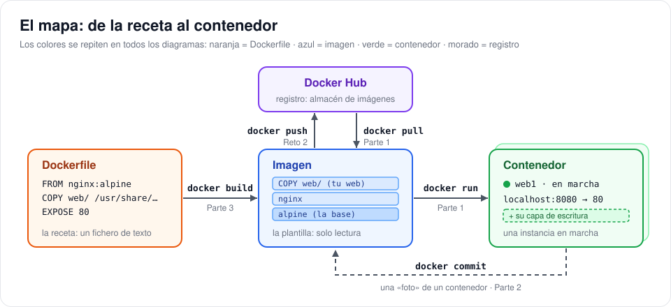
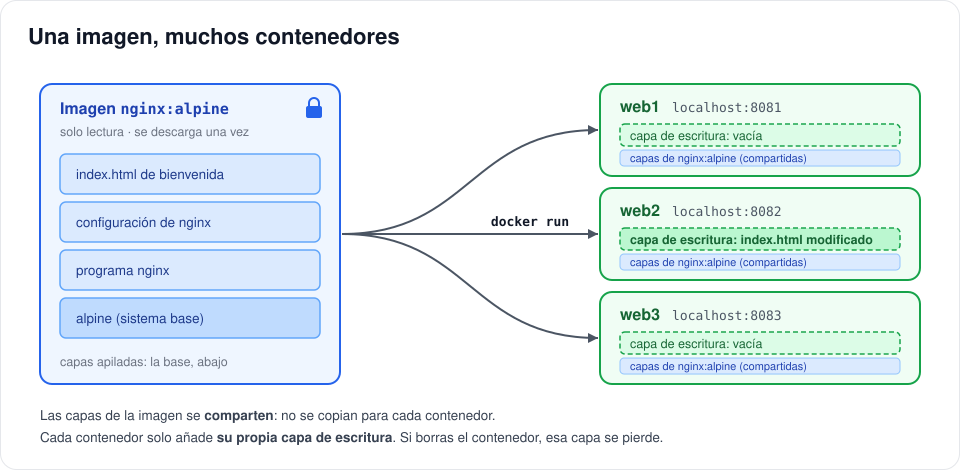
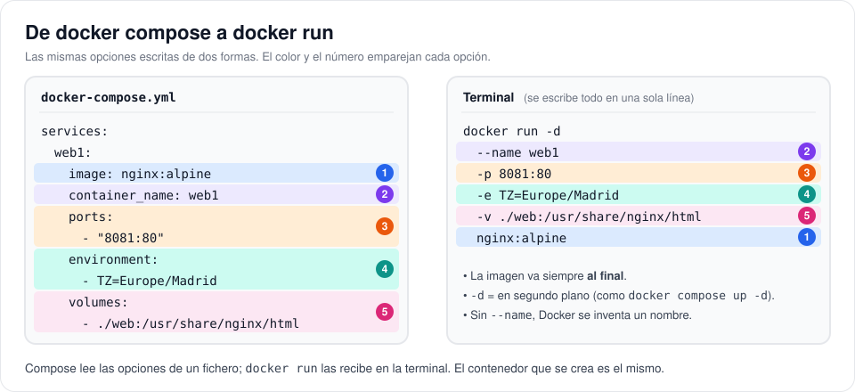
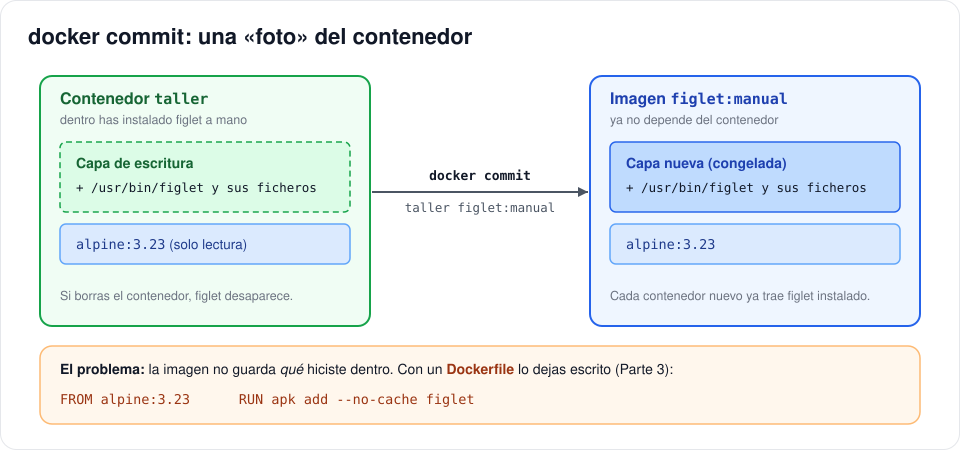
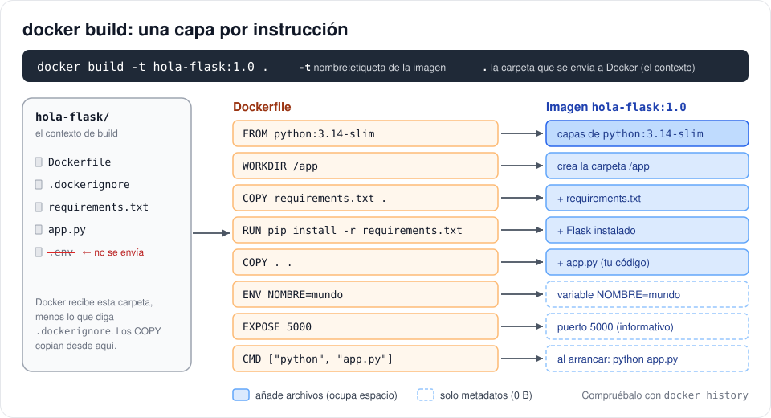
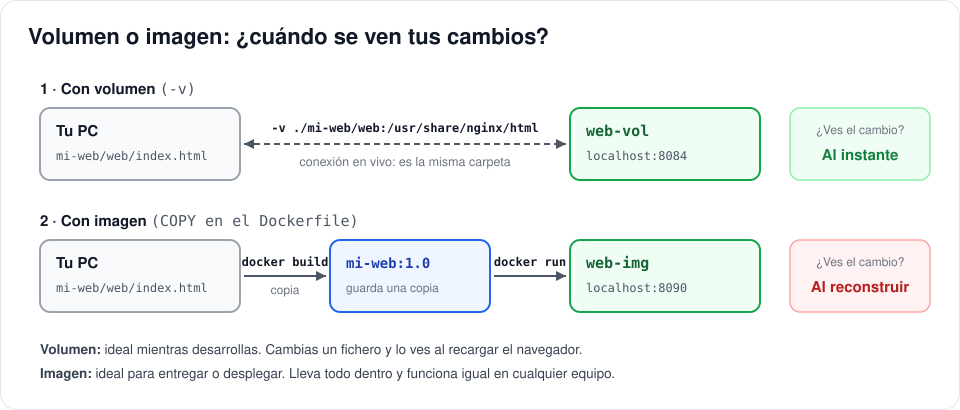
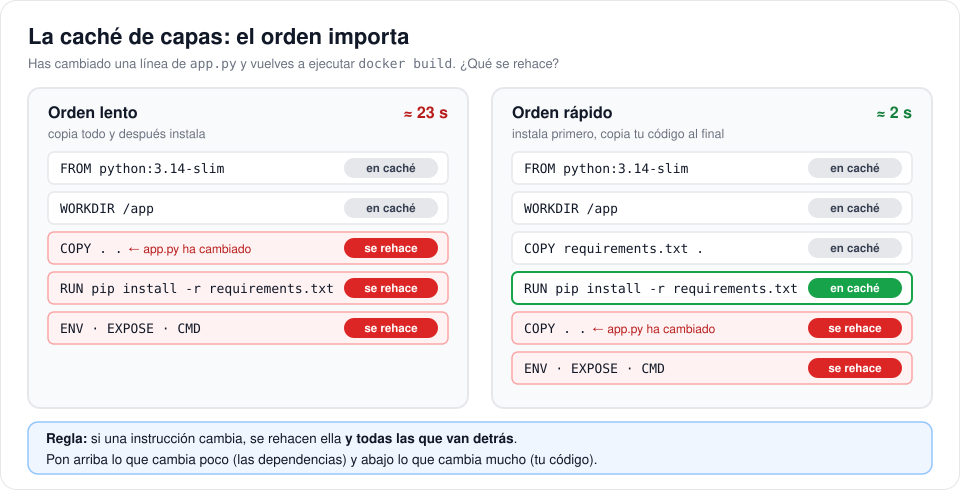
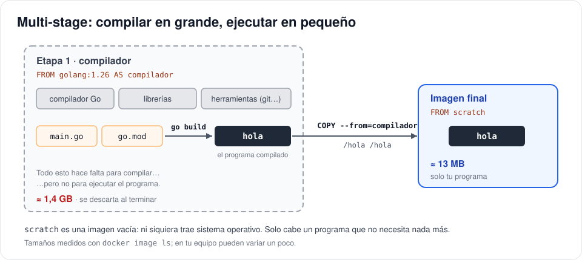

# 🐳 Práctica: crea tus propias imágenes Docker

Hasta ahora has usado imágenes que había hecho otra persona (`nginx`, `mysql`, `wordpress`…) y las has arrancado con `docker compose`. En esta práctica das el paso siguiente: vas a **lanzar contenedores a mano** con `docker run`, a **crear tus propias imágenes** con un `Dockerfile` y, al final, a **usarlas desde Docker Compose**.

Empezamos por lo más básico y cada parte añade un concepto nuevo. No te saltes ninguna: cada una se apoya en la anterior.

> [!NOTE]
> **Duración estimada:** unas 6 horas (los retos opcionales, aparte).
> **Necesitas:** Docker Desktop en marcha, Git y VS Code. Usa la **terminal de VS Code con PowerShell** (más abajo verás por qué no Git Bash).

**Índice**

- [🎯 Qué vas a aprender](#-qué-vas-a-aprender)
- [🧭 El mapa de la práctica](#-el-mapa-de-la-práctica)
- [🧰 Parte 0 · Prepara tu carpeta](#-parte-0--prepara-tu-carpeta)
- [🚀 Parte 1 · Contenedores a partir de imágenes](#-parte-1--contenedores-a-partir-de-imágenes)
- [📸 Parte 2 · Tu primera imagen, a mano](#-parte-2--tu-primera-imagen-a-mano)
- [📜 Parte 3 · El Dockerfile](#-parte-3--el-dockerfile)
- [🐙 Parte 4 · Tus imágenes en Docker Compose](#-parte-4--tus-imágenes-en-docker-compose)
- [⭐ Retos opcionales](#-retos-opcionales)
- [📋 Chuleta de comandos](#-chuleta-de-comandos)
- [🩺 Si algo falla](#-si-algo-falla)
- [🧹 Limpieza](#-limpieza)
- [✅ Entrega](#-entrega)
- [✍️ Tus respuestas](#️-tus-respuestas)

---

## 🎯 Qué vas a aprender

| Parte | Qué haces | Qué aprendes |
|---|---|---|
| 0 | Preparas la carpeta de la práctica | El flujo de siempre: clonar → trabajar → publicar |
| 1 | Lanzas contenedores con `docker run` | Imagen y contenedor, `-d`, `-p`, `-e`, `-v`, `exec`, y cómo pasar de compose a `docker run` |
| 2 | Creas una imagen «a mano» con `docker commit` | Qué son las capas y por qué necesitamos un Dockerfile |
| 3 | Escribes Dockerfiles: un programa, una web y una app Python | `FROM`, `RUN`, `COPY`, `WORKDIR`, `ENV`, `EXPOSE`, `CMD`, `ENTRYPOINT`, `.dockerignore`, la caché y las etiquetas |
| 4 | Usas tus imágenes desde Docker Compose | `build:` y `docker compose up --build` |
| ⭐ | Haces una imagen diminuta y la publicas en Docker Hub | Builds multi-stage y registros |

Todas las preguntas se responden en la sección [✍️ Tus respuestas](#️-tus-respuestas), al final de este README. Cuando veas **📝**, toca escribir algo allí.

---

## 🧭 El mapa de la práctica

Antes de empezar, mira este mapa. Resume toda la práctica: vuelve a él cada vez que te pierdas.



- **Dockerfile** (naranja): un fichero de texto con los pasos para fabricar una imagen. Es la receta.
- **Imagen** (azul): una plantilla de solo lectura con todo lo que necesita un programa para funcionar: sistema base, programas, configuración y tus ficheros.
- **Contenedor** (verde): una imagen **en marcha**. De una misma imagen puedes crear todos los contenedores que quieras.
- **Registro** (morado): un almacén de imágenes en internet. El más conocido es **Docker Hub**, de donde salen `nginx`, `mysql`…

Con `docker compose up` ya has hecho `pull` y `run` muchas veces, solo que compose lo hacía por ti. Ahora lo vas a hacer tú, paso a paso.

---

## 🧰 Parte 0 · Prepara tu carpeta

### 1. Clona este repositorio dentro de tu repositorio de la asignatura

Abre la carpeta de tu repositorio en VS Code y, en la terminal (PowerShell):

```powershell
git clone https://github.com/CIFPZornotzaLHII/docker-images
cd docker-images
```

### 2. Borra la carpeta `.git` de `docker-images`

Así `docker-images` pasa a formar parte de **tu** repositorio. Si no lo haces, Git lo trata como un repositorio anidado y **su contenido no se subirá a GitHub**.

```powershell
Remove-Item -Recurse -Force .git
```

> [!WARNING]
> Comprueba que estás **dentro de `docker-images`** antes de ejecutarlo. Si lo haces en la raíz, borrarás el historial de **tu** repositorio.

### 3. Mira lo que hay

```text
docker-images/
├── readme.md            ← este enunciado (y tus respuestas, al final)
├── docs/img/            ← los diagramas
├── mi-web/
│   └── web/
│       └── index.html   ← una web sencilla (Partes 1 y 3)
├── hola-flask/
│   ├── app.py           ← una app web en Python (Parte 3)
│   └── requirements.txt
└── hola-go/             ← un programa en Go (reto opcional)
    ├── main.go
    └── go.mod
```

Durante la práctica irás creando más ficheros: `Dockerfile`, `.dockerignore` y `docker-compose.yml`.

> [!IMPORTANT]
> A partir de aquí, **todos los comandos se ejecutan desde la carpeta `docker-images`**, salvo cuando el enunciado te diga que entres en otra.

### 4. Publica en GitHub

```powershell
git add --all
git commit -m "Añade la práctica docker-images"
git push
```

---

## 🚀 Parte 1 · Contenedores a partir de imágenes

### 🧠 Conceptos

Una comparación que te ayudará:

| Docker | Se parece a… | Ejemplo |
|---|---|---|
| **Imagen** | Una ISO o una plantilla de máquina virtual: no se «enciende», sirve para crear máquinas | `nginx:alpine` |
| **Contenedor** | Una máquina encendida creada a partir de esa plantilla. Puedes crear muchas iguales | `web1`, `web2` |
| **Dockerfile** | El guion de instalación: «parte de esto, instala aquello, copia esto otro» | `figlet/Dockerfile` |
| **Registro** | La web de la que descargas las ISO | Docker Hub |

> [!TIP]
> Si sabes programar: la **imagen** es la **clase** y el **contenedor** es un **objeto** (una instancia) de esa clase.

Las imágenes tienen un nombre con la forma **`nombre:etiqueta`**:

- `nginx:alpine` → imagen `nginx`, etiqueta `alpine` (la variante construida sobre Alpine Linux, muy ligera).
- `mysql:8.0` → imagen `mysql`, etiqueta `8.0` (la versión).
- `traefik/whoami` → imagen `whoami` del usuario u organización `traefik`. Las imágenes oficiales no llevan ese prefijo.
- Si no pones etiqueta, Docker usa **`latest`**: `nginx` es lo mismo que `nginx:latest`.

Y lo más importante de esta parte:



1. Una imagen está hecha de **capas** apiladas y es de **solo lectura**: nadie la modifica.
2. Un contenedor es la imagen **más una capa de escritura propia**. Todo lo que cambia dentro del contenedor se guarda en esa capa.
3. Un contenedor **vive mientras vive su proceso principal**. Si el programa termina, el contenedor se para.
4. Si **borras** un contenedor, su capa de escritura **desaparece** con él.

En los ejercicios vas a comprobar cada uno de estos puntos.

### Ejercicio 1.1 · Descarga una imagen

```powershell
docker pull nginx:alpine
docker image ls
```

`pull` descarga la imagen desde Docker Hub. `docker image ls` lista las imágenes que tienes en tu equipo.

📝 **1.1** En `nginx:alpine`, ¿qué es `nginx` y qué es `alpine`? Pega la salida de `docker image ls nginx`.

### Ejercicio 1.2 · Tu primer `docker run`

```powershell
docker run nginx:alpine
```

Verás los mensajes de arranque de nginx y la terminal se quedará «bloqueada»: el contenedor está en **primer plano** y te muestra lo que escribe nginx. Pulsa **Ctrl+C** para pararlo.

Ahora mira los contenedores:

```powershell
docker ps        # solo los que están en marcha
docker ps -a     # todos, también los parados
```

📝 **1.2** ¿Por qué se quedó «bloqueada» la terminal? Tras Ctrl+C, ¿en qué estado aparece el contenedor en `docker ps -a`? ¿Qué nombre le puso Docker?

### Ejercicio 1.3 · En segundo plano, con nombre y con puerto

```powershell
docker run -d --name web1 -p 8081:80 nginx:alpine
```

| Opción | Qué hace |
|---|---|
| `-d` | Lo arranca en **segundo plano** (*detached*): te devuelve la terminal. Es lo que hace `docker compose up -d` |
| `--name web1` | Le pone nombre. Si no, Docker se inventa uno |
| `-p 8081:80` | Publica el puerto: **8081 de tu equipo** → **80 del contenedor**. Igual que `ports:` en compose |
| `nginx:alpine` | La imagen. **Siempre va al final** de las opciones |

Abre <http://localhost:8081>: verás la página de bienvenida de nginx. Prueba también:

```powershell
docker ps
docker logs web1     # lo que ha escrito el contenedor
docker stop web1     # lo para (sigue existiendo)
docker ps -a
docker start web1    # lo vuelve a arrancar
```

📝 **1.3** Pega la salida de `docker ps` con `web1` en marcha. ¿Qué diferencia hay entre `docker stop` y `docker rm`?

### Ejercicio 1.4 · Una imagen, muchos contenedores

Crea dos contenedores más **a partir de la misma imagen**:

```powershell
docker run -d --name web2 -p 8082:80 nginx:alpine
docker run -d --name web3 -p 8083:80 nginx:alpine
docker image ls
```

Ahora vas a **entrar** en `web2` y cambiar su página de inicio. `docker exec` ejecuta un comando dentro de un contenedor que ya está en marcha; con `-it` y `sh` abres una terminal dentro:

```powershell
docker exec -it web2 sh
```

El indicador cambia a `/ #`: **estás dentro del contenedor**. Escribe:

```sh
echo "<h1>Soy web2</h1>" > /usr/share/nginx/html/index.html
exit
```

Abre <http://localhost:8081>, <http://localhost:8082> y <http://localhost:8083>.

✔️ Solo ha cambiado la página de `web2`: el cambio está en **su** capa de escritura, como en el diagrama de arriba.

📝 **1.4** Tienes tres contenedores nginx: ¿cuántas imágenes `nginx:alpine` aparecen en `docker image ls`? ¿Por qué solo cambió la página de `web2`?

### Ejercicio 1.5 · Los contenedores son de usar y tirar

Borra `web2` y vuelve a crearlo con el mismo comando:

```powershell
docker rm -f web2
docker run -d --name web2 -p 8082:80 nginx:alpine
```

Recarga <http://localhost:8082>. ¿Sigue diciendo «Soy web2»?

Ahora un contenedor **interactivo** y **desechable**:

```powershell
docker run -it --rm alpine:3.23 sh
```

Dentro, curiosea un poco y sal:

```sh
cat /etc/os-release
ls /
exit
```

```powershell
docker ps -a
```

| Opción | Qué hace |
|---|---|
| `-it` | Modo interactivo: conecta tu teclado y tu pantalla con el contenedor |
| `--rm` | Borra el contenedor automáticamente al terminar |
| `sh` | Lo que va **después de la imagen** es el comando que ejecuta el contenedor (como `command:` en compose) |

📝 **1.5** Tras borrar y volver a crear `web2`, ¿sigue tu cambio? ¿Dónde estaba guardado? ¿Aparece el contenedor de alpine en `docker ps -a`? ¿Por qué?

> [!IMPORTANT]
> **Conclusión:** lo que cambias *dentro* de un contenedor se pierde al borrarlo. Para conservar datos se usan **volúmenes**. Para que un cambio forme parte de la imagen hay que **crear una imagen nueva**, que es justo lo que harás en las Partes 2 y 3.

### Ejercicio 1.6 · De Docker Compose a `docker run`

Todo lo que escribías en un `docker-compose.yml` se puede escribir como opciones de `docker run`:



| En `docker-compose.yml` | En `docker run` |
|---|---|
| `image: nginx:alpine` | `nginx:alpine` (al final) |
| `container_name: web1` | `--name web1` |
| `ports: - "8081:80"` | `-p 8081:80` |
| `environment: - TZ=Europe/Madrid` | `-e TZ=Europe/Madrid` |
| `volumes: - ./web:/usr/share/nginx/html` | `-v ./web:/usr/share/nginx/html` |
| `restart: always` | `--restart always` |
| `command: sh` | `sh` (después de la imagen) |
| `docker compose up -d` | `-d` |

**a) Un volumen con `-v`.** Sirve la web de la carpeta `mi-web/web` con un nginx:

```powershell
docker run -d --name web-vol -p 8084:80 -v ./mi-web/web:/usr/share/nginx/html nginx:alpine
```

Abre <http://localhost:8084>. Después, abre `mi-web/web/index.html` en VS Code, cambia `TU_NOMBRE` por tu nombre, guarda y recarga el navegador.

**b) Variables de entorno con `-e`.** El comando `env` muestra las variables de entorno del contenedor:

```powershell
docker run --rm -e NOMBRE=Ane -e CURSO=Docker alpine:3.23 env
```

**c) Traduce tú.** Escribe el `docker run` equivalente a este compose, ejecútalo y abre <http://localhost:8085>:

```yaml
services:
  quien:
    image: traefik/whoami
    container_name: quien
    ports:
      - "8085:80"
    environment:
      - WHOAMI_NAME=clase-docker
```

✔️ Si lo has traducido bien, la página mostrará la línea `Name: clase-docker`.

**d) Y al revés.** Escribe el `docker-compose.yml` equivalente a este comando (no hace falta que lo ejecutes):

```powershell
docker run -d --name cajon --restart always -p 8086:80 -e TZ=Europe/Madrid nginx:alpine
```

📝 **1.6** ¿Qué pasó en <http://localhost:8084> al editar `index.html`? ¿Por qué? Escribe tu comando del apartado c) y tu compose del apartado d).

Sube los cambios:

```powershell
git add --all
git commit -m "Parte 1: contenedores con docker run"
git push
```

---

## 📸 Parte 2 · Tu primera imagen, a mano

### 🧠 Conceptos

En la Parte 1 viste que los cambios hechos dentro de un contenedor se pierden. Pero hay una forma de conservarlos: **`docker commit`** congela la capa de escritura de un contenedor y la convierte en una capa más de una **imagen nueva**.



Lo vas a probar con **figlet**, un programa que escribe texto con letras grandes.

### Ejercicio 2.1 · Instala un programa dentro de un contenedor

Arranca un contenedor Alpine interactivo llamado `taller` (esta vez **sin** `--rm`, porque lo necesitas después):

```powershell
docker run -it --name taller alpine:3.23 sh
```

Dentro del contenedor:

```sh
figlet Hola                 # falla: figlet no está instalado
apk add --no-cache figlet   # apk es el gestor de paquetes de Alpine (como apt en Ubuntu)
figlet Hola                 # ahora sí
exit
```

### Ejercicio 2.2 · Congela el contenedor en una imagen

```powershell
docker commit taller figlet:manual
docker image ls figlet
docker run --rm figlet:manual figlet Hola Docker
```

✔️ Un contenedor **nuevo**, creado a partir de `figlet:manual`, ya trae figlet instalado.

Ahora mira de qué capas está hecha la imagen:

```powershell
docker history figlet:manual
```

`docker history` lista las capas de una imagen, de la más nueva (arriba) a la más antigua (abajo), con el comando que creó cada una y lo que ocupa.

📝 **2.1** Pega la salida de `docker history figlet:manual`. ¿Qué línea es la capa que has creado tú? ¿Aparece el comando `apk add` que escribiste?

📝 **2.2** Imagina que un compañero necesita la misma imagen, pero con la versión nueva de Alpine que saldrá el año que viene. Da **dos problemas** de crear imágenes con `docker commit`.

```powershell
docker rm taller
git add --all
git commit -m "Parte 2: docker commit"
git push
```

---

## 📜 Parte 3 · El Dockerfile

### 🧠 Conceptos

Un **Dockerfile** es un fichero de texto llamado exactamente `Dockerfile` (con D mayúscula y **sin extensión**) que contiene, paso a paso, cómo fabricar una imagen. Es como escribir en un papel lo que hiciste a mano en la Parte 2, para que **cualquiera pueda repetirlo** con un solo comando:

```powershell
docker build -t nombre:etiqueta .
```

- `-t` pone nombre y etiqueta a la imagen.
- El `.` final es el **contexto**: la carpeta que se envía a Docker para construir. Los `COPY` del Dockerfile copian ficheros **desde esa carpeta**. ¡No te olvides del punto!

`docker build` lee el Dockerfile de arriba abajo y **cada instrucción genera una capa**:



Este diagrama muestra el Dockerfile de la app Python al que llegarás en el ejercicio 3.6. Estas son las instrucciones que vas a usar:

| Instrucción | Qué hace | Ejemplo |
|---|---|---|
| `FROM` | Imagen de partida. Siempre es la primera línea | `FROM nginx:alpine` |
| `RUN` | Ejecuta un comando **al construir** la imagen y guarda el resultado en una capa | `RUN apk add --no-cache figlet` |
| `COPY` | Copia ficheros del contexto (tu carpeta) a la imagen | `COPY web/ /usr/share/nginx/html/` |
| `WORKDIR` | Carpeta de trabajo para las instrucciones siguientes y para el contenedor (como un `cd`) | `WORKDIR /app` |
| `ENV` | Define una variable de entorno con un valor por defecto | `ENV NOMBRE=mundo` |
| `EXPOSE` | **Documenta** el puerto que usa la aplicación. No lo publica: eso lo hace `-p` | `EXPOSE 5000` |
| `CMD` | Comando que se ejecuta **al arrancar** cada contenedor. Se puede sustituir desde `docker run` | `CMD ["python", "app.py"]` |
| `ENTRYPOINT` | Programa que se ejecuta **siempre** al arrancar. Si existe, `CMD` pasa a ser sus argumentos | `ENTRYPOINT ["figlet"]` |

> [!IMPORTANT]
> **`RUN` se ejecuta al construir** la imagen, una sola vez, en `docker build`.
> **`CMD` se ejecuta al arrancar** cada contenedor, en `docker run`.
> Instalar programas → `RUN`. Arrancar tu aplicación → `CMD`.

> [!TIP]
> Escribe `CMD` y `ENTRYPOINT` en formato lista, con **comillas dobles**: `CMD ["python", "app.py"]`. Con comillas simples no funciona.

### Ejercicio 3.1 · figlet, ahora con Dockerfile

Crea la carpeta `figlet` y, dentro, un fichero llamado `Dockerfile` con este contenido (en VS Code: *Nuevo archivo* → `figlet/Dockerfile`):

```dockerfile
FROM alpine:3.23
RUN apk add --no-cache figlet
CMD ["figlet", "Hola Docker"]
```

Entra en la carpeta y construye la imagen:

```powershell
cd figlet
docker build -t figlet:1.0 .
docker image ls figlet
```

Pruébala:

```powershell
docker run --rm figlet:1.0                  # usa el CMD
docker run --rm figlet:1.0 figlet Adios     # lo que escribes tras la imagen sustituye al CMD
docker history figlet:1.0
cd ..
```

📝 **3.1** ¿Qué pasó al escribir `figlet Adios` detrás de la imagen? Compara `docker history figlet:1.0` con el de `figlet:manual`: ¿qué ventaja tiene la imagen hecha con Dockerfile?

### Ejercicio 3.2 · ENTRYPOINT + CMD

Escribir `figlet` cada vez es un rollo. Cambia el `Dockerfile` de `figlet` para que figlet sea el programa fijo (`ENTRYPOINT`) y el texto por defecto sea el `CMD`:

```dockerfile
FROM alpine:3.23
RUN apk add --no-cache figlet
ENTRYPOINT ["figlet"]
CMD ["Hola Docker"]
```

```powershell
cd figlet
docker build -t figlet:2.0 .
docker run --rm figlet:2.0
docker run --rm figlet:2.0 Adios
docker run --rm figlet:2.0 -c Centrado
cd ..
```

✔️ Ahora la imagen se comporta como un comando: lo que escribes detrás de la imagen son los **argumentos** de figlet.

📝 **3.2** Explica con tus palabras la diferencia entre `ENTRYPOINT` y `CMD` usando lo que has visto con `figlet:2.0`.

### Ejercicio 3.3 · Tu web dentro de una imagen

En el ejercicio 1.6 servías `mi-web/web` con un **volumen**. Ahora vas a meter la web **dentro de una imagen**, para que funcione en cualquier equipo sin necesitar tu carpeta.

Crea `mi-web/Dockerfile` y **complétalo tú**. Solo necesita dos instrucciones:

```dockerfile
# ¿Qué imagen sabe servir páginas web? La usaste en la Parte 1.
FROM ________

# Copia la carpeta web/ del contexto a la carpeta de la que nginx sirve las páginas.
# Pista: es la ruta del volumen del ejercicio 1.6.
COPY ________ ________
```

> [!WARNING]
> En un Dockerfile, los comentarios (`#`) van **en su propia línea**. Si escribes un comentario al final de una instrucción, Docker lo toma como parte de ella.

Construye y arranca:

```powershell
cd mi-web
docker build -t mi-web:1.0 .
cd ..
docker run -d --name web-img -p 8090:80 mi-web:1.0
```

Abre <http://localhost:8090>: debe salir tu web, con tu nombre.

Ahora compara **volumen** e **imagen**. Si borraste `web-vol`, vuelve a crearlo con el comando del ejercicio 1.6.

1. En `mi-web/web/index.html`, cambia `Versión: <strong>1.0</strong>` por `2.0` y guarda.
2. Recarga <http://localhost:8084> (`web-vol`, volumen) y <http://localhost:8090> (`web-img`, imagen).



3. Para que la imagen tenga la versión 2.0, hay que **reconstruirla** y crear un contenedor nuevo:

```powershell
cd mi-web
docker build -t mi-web:2.0 .
cd ..
docker rm -f web-img
docker run -d --name web-img -p 8090:80 mi-web:2.0
```

| | Volumen (`-v`) | Imagen (`COPY`) |
|---|---|---|
| ¿Cuándo se copian los ficheros? | Nunca: el contenedor usa tu carpeta | Al hacer `docker build` |
| Si editas un fichero… | Se ve al instante | Hay que reconstruir la imagen |
| ¿Funciona en otro equipo sin tu carpeta? | No | Sí |
| Ideal para… | Desarrollar y guardar datos (bases de datos) | Entregar y desplegar tu aplicación |

📝 **3.3** Pega tu `mi-web/Dockerfile`. Al cambiar a «Versión 2.0», ¿qué web mostró el cambio y cuál no? ¿Por qué? ¿Cuándo usarías un volumen y cuándo `COPY`?

### Ejercicio 3.4 · Una aplicación Python

En `hola-flask/` tienes una pequeña aplicación web en Python (`app.py`) que usa la librería **Flask** (`requirements.txt`). No necesitas saber Python: solo saber que, para funcionar, hace falta:

1. Una imagen con Python.
2. Instalar las librerías con `pip install -r requirements.txt`.
3. Arrancarla con `python app.py`. Escucha en el puerto **5000**.

Crea `hola-flask/Dockerfile` con este contenido:

```dockerfile
FROM python:3.14-slim
WORKDIR /app
COPY . .
RUN pip install -r requirements.txt
ENV NOMBRE=mundo
EXPOSE 5000
CMD ["python", "app.py"]
```

```powershell
cd hola-flask
docker build -t hola-flask:1.0 .
docker run -d --name hola -p 5000:5000 hola-flask:1.0
```

Abre <http://localhost:5000>: «¡Hola, mundo!». La línea «Te responde el contenedor…» muestra el **nombre de máquina** del contenedor: compáralo con su ID en `docker ps`.

Ahora pásale tu nombre con `-e`:

```powershell
docker rm -f hola
docker run -d --name hola -p 5000:5000 -e NOMBRE=TuNombre hola-flask:1.0
```

Y comprueba si `EXPOSE` publica el puerto. Arranca otro contenedor **sin** `-p` y mira la columna `PORTS`:

```powershell
docker run -d --name hola-sin-puerto hola-flask:1.0
docker ps
```

📝 **3.4** Completa la tabla de las respuestas con lo que hace cada instrucción del Dockerfile. ¿Qué valor de `NOMBRE` gana, el de `ENV` o el de `-e`? ¿`EXPOSE` publica el puerto? ¿Cómo lo has comprobado?

### Ejercicio 3.5 · `.dockerignore`: lo que no debe entrar

Con `COPY . .` se copia **todo** el contexto a la imagen. ¿Todo? Vamos a verlo.

1. Dentro de `hola-flask/`, crea con VS Code un fichero llamado `.env` con esta línea (una contraseña de mentira):

   ```text
   PASSWORD=supersecreta
   ```

2. Reconstruye y mira qué hay dentro de la imagen:

   ```powershell
   docker build -t hola-flask:1.1 .
   docker run --rm hola-flask:1.1 ls -a
   docker run --rm hola-flask:1.1 cat .env
   ```

   😱 La contraseña está **dentro de la imagen**. Cualquiera que tenga la imagen puede leerla.

3. Crea en `hola-flask/` un fichero llamado `.dockerignore`. Funciona como `.gitignore`: lo que pongas ahí **no se envía** a Docker al construir.

   ```text
   .env
   Dockerfile
   .dockerignore
   ```

4. Vuelve a construir y comprueba:

   ```powershell
   docker build -t hola-flask:1.2 .
   docker run --rm hola-flask:1.2 ls -a
   ```

📝 **3.5** Pega la salida de `ls -a` de las imágenes `1.1` y `1.2`. ¿Por qué es peligroso que un `.env` acabe dentro de una imagen?

> [!NOTE]
> En un proyecto real, el `.env` también iría en el `.gitignore`. Aquí lo dejamos porque la contraseña es de mentira.

### Ejercicio 3.6 · La caché de capas: el orden importa

Docker guarda cada capa que construye. Si vuelves a construir y una instrucción (y lo que copia) no ha cambiado, **reutiliza la capa** (`CACHED`) en lugar de repetirla. Pero hay una trampa:



**a) Comprueba el problema.** En `app.py`, cambia `VERSION = "1.0"` por `VERSION = "1.3"` y reconstruye. Con `--progress=plain` ves todos los pasos:

```powershell
docker build --progress=plain -t hola-flask:1.3 .
```

Fíjate en el paso `RUN pip install`: ¿pone `CACHED` o vuelve a descargar Flask (`Collecting flask…`)? Has cambiado **una línea de tu código** y Docker ha reinstalado **todas las librerías**.

**b) Arréglalo.** Cambia el orden del Dockerfile: copia primero solo `requirements.txt`, instala, y copia el resto del código al final:

```dockerfile
FROM python:3.14-slim
WORKDIR /app
COPY requirements.txt .
RUN pip install -r requirements.txt
COPY . .
ENV NOMBRE=mundo
EXPOSE 5000
CMD ["python", "app.py"]
```

```powershell
docker build --progress=plain -t hola-flask:1.4 .
```

Esta vez `pip install` se ejecuta (has cambiado el Dockerfile). Ahora cambia `VERSION` a `"2.0"` en `app.py` y reconstruye:

```powershell
docker build --progress=plain -t hola-flask:2.0 .
```

✔️ `RUN pip install` sale `CACHED` y la construcción tarda un par de segundos. En el equipo del profe: **23 s con el orden lento y 2 s con el rápido**.

📝 **3.6** Pega las líneas de la última construcción que dicen `CACHED`. Explica con tus palabras la regla de la caché y pega tu Dockerfile final.

### Ejercicio 3.7 · Etiquetas y versiones

Has ido construyendo varias versiones de la misma imagen. Míralas:

```powershell
docker image ls hola-flask
```

Varias versiones pueden funcionar **a la vez**:

```powershell
docker rm -f hola hola-sin-puerto
docker run -d --name hola-v1 -p 5001:5000 hola-flask:1.0
docker run -d --name hola-v2 -p 5002:5000 hola-flask:2.0
```

Abre <http://localhost:5001> y <http://localhost:5002>. Si la versión nueva tuviera un fallo, volver atrás sería tan fácil como arrancar la anterior.

Una imagen puede tener **varias etiquetas** a la vez. `docker tag` añade una etiqueta nueva a una imagen que ya existe:

```powershell
docker tag hola-flask:2.0 hola-flask:latest
docker image ls hola-flask
```

Fíjate en la columna `ID`: `2.0` y `latest` son **la misma imagen** con dos nombres.

> [!WARNING]
> Los nombres de imagen van **en minúsculas**. `Hola-Flask:1.0` da el error `repository name must be lowercase`.

📝 **3.7** Pega la salida de `docker image ls hola-flask`. ¿`latest` es siempre la versión más nueva? ¿Por qué no conviene usar solo `latest`?

```powershell
cd ..
git add --all
git commit -m "Parte 3: Dockerfiles"
git push
```

---

## 🐙 Parte 4 · Tus imágenes en Docker Compose

### 🧠 Conceptos

Hasta ahora, en compose siempre usabas `image:` para descargar una imagen de Docker Hub. Con **`build:`**, compose construye la imagen a partir de un Dockerfile:

| En el servicio | Qué hace compose |
|---|---|
| `image: nginx:alpine` | Descarga la imagen (si no la tiene) y la usa |
| `build: ./mi-web` | Construye la imagen con el Dockerfile de esa carpeta |
| `build:` + `image:` | Construye la imagen y le pone ese nombre |

### Ejercicio 4.1 · Tu primer compose con `build:`

Antes, borra los contenedores de las partes anteriores para liberar los puertos:

```powershell
docker rm -f web1 web2 web3 web-vol web-img quien hola hola-sin-puerto hola-v1 hola-v2
```

Si alguno no existe, Docker avisa con un error y sigue con los demás: no pasa nada.

Crea `docker-compose.yml` en la carpeta `docker-images` con dos servicios: tu web y tu app Python.

```yaml
services:
  web:
    build: ./mi-web
    image: mi-web:compose
    ports:
      - "8080:80"

  saludo:
    build: ./hola-flask
    image: hola-flask:compose
    environment:
      NOMBRE: "Compose"
    ports:
      - "5000:5000"
```

```powershell
docker compose up -d
docker image ls
```

✔️ Verás que compose **construye** las dos imágenes antes de arrancar los contenedores. Comprueba <http://localhost:8080> y <http://localhost:5000>.

### Ejercicio 4.2 · La trampa: cambias el código y no pasa nada

1. En `hola-flask/app.py`, cambia `VERSION` a `"3.0"` y guarda.
2. Aplica los cambios como siempre y recarga <http://localhost:5000>:

   ```powershell
   docker compose up -d
   ```

3. ¿Pone 3.0? Ahora prueba con `--build`:

   ```powershell
   docker compose up -d --build
   ```

> [!TIP]
> `docker compose up -d` **solo construye la imagen si no existe**. Si ya existe, usa la que tiene, aunque hayas cambiado el código. Con `--build` le obligas a reconstruir. También puedes construir sin arrancar con `docker compose build`.

📝 **4.1** Pega tu `docker-compose.yml`.

📝 **4.2** ¿Qué pasó con `docker compose up -d` tras cambiar el código? ¿Y con `--build`? ¿Por qué? Si quitas la línea `image:` de un servicio, ¿qué nombre pone compose a la imagen? (Pruébalo y mira `docker image ls`).

```powershell
docker compose down
git add --all
git commit -m "Parte 4: compose con build"
git push
```

---

## ⭐ Retos opcionales

### Reto 1 · Una imagen diminuta con multi-stage

En `hola-go/` tienes un programa web escrito en Go. Go es un lenguaje **compilado**: el código (`main.go`) se convierte en un programa ejecutable (`hola`). Para compilar necesitas la imagen `golang`, que es enorme… pero para **ejecutar** el programa no necesitas nada de eso.

**a) Primero, la versión grande.** Crea `hola-go/Dockerfile`:

```dockerfile
FROM golang:1.26
WORKDIR /src
COPY . .
RUN go build -o /hola .
EXPOSE 8080
CMD ["/hola"]
```

```powershell
cd hola-go
docker build -t hola-go:grande .
```

**b) Ahora, multi-stage.** Un Dockerfile puede tener **varios `FROM`**. Cada uno empieza una **etapa**, y solo la última forma la imagen final. Con `COPY --from=` te traes ficheros de una etapa anterior:



Sustituye el Dockerfile por este y **completa los huecos**:

```dockerfile
# Etapa 1: compilar
FROM golang:1.26 AS compilador
WORKDIR /src
COPY . .
# CGO_ENABLED=0 crea un programa que no necesita ninguna librería del sistema
RUN CGO_ENABLED=0 go build -o /hola .

# Etapa 2: la imagen final (pista: una imagen completamente vacía)
FROM ________
COPY --from=________ /hola /hola
EXPOSE 8080
CMD ["/hola"]
```

```powershell
docker build -t hola-go:mini .
docker image ls hola-go
docker run -d --name go-mini -p 8088:8080 hola-go:mini
cd ..
```

Abre <http://localhost:8088>. Después intenta entrar en el contenedor:

```powershell
docker exec -it go-mini sh
```

📝 **R1** Pega la salida de `docker image ls hola-go`. ¿Por qué no puedes hacer `docker exec -it go-mini sh`? Pega tu Dockerfile multi-stage.

### Reto 2 · Publica tu imagen en Docker Hub

Cierra el círculo del [mapa](#-el-mapa-de-la-práctica): `push`.

1. Crea una cuenta gratuita en <https://hub.docker.com>.
2. Inicia sesión desde la terminal:

   ```powershell
   docker login
   ```

3. Para subir una imagen, su nombre tiene que empezar por tu usuario. Ponle una etiqueta nueva y súbela:

   ```powershell
   docker tag hola-flask:2.0 TU_USUARIO/hola-flask:2.0
   docker push TU_USUARIO/hola-flask:2.0
   ```

4. Pide a un compañero que la ejecute en su equipo:

   ```powershell
   docker run -d -p 5000:5000 -e NOMBRE=Compañero TU_USUARIO/hola-flask:2.0
   ```

📝 **R2** Pega la URL de tu imagen en Docker Hub. ¿Por qué **no** debes subir nunca `hola-flask:1.1`?

---

## 📋 Chuleta de comandos

| Comando | Qué hace |
|---|---|
| `docker pull nginx:alpine` | Descarga una imagen |
| `docker image ls` | Lista las imágenes |
| `docker run -d --name web -p 8080:80 nginx:alpine` | Crea y arranca un contenedor en segundo plano |
| `docker run -it --rm alpine:3.23 sh` | Contenedor interactivo que se borra al salir |
| `docker ps` / `docker ps -a` | Contenedores en marcha / todos |
| `docker logs web` | Muestra lo que ha escrito el contenedor |
| `docker exec -it web sh` | Abre una terminal dentro de un contenedor en marcha |
| `docker stop web` / `docker start web` | Para / arranca un contenedor |
| `docker rm -f web` | Borra un contenedor (aunque esté en marcha) |
| `docker commit web mi-imagen:1.0` | Crea una imagen a partir de un contenedor |
| `docker build -t mi-imagen:1.0 .` | Construye una imagen con el Dockerfile de la carpeta actual |
| `docker history mi-imagen:1.0` | Muestra las capas de una imagen |
| `docker tag mi-imagen:1.0 mi-imagen:latest` | Añade otra etiqueta a una imagen |
| `docker rmi mi-imagen:1.0` | Borra una imagen |
| `docker image prune` | Borra las imágenes `<none>` que ya no usa nadie |
| `docker compose up -d --build` | Reconstruye las imágenes y levanta los servicios |

---

## 🩺 Si algo falla

- **`port is already allocated`**: ese puerto de tu equipo ya lo usa otro contenedor. Míralo con `docker ps` y bórralo, o usa otro puerto.
- **`The container name "/web1" is already in use`**: ya existe un contenedor con ese nombre, aunque esté parado. Bórralo con `docker rm -f web1`.
- **`failed to read dockerfile` / `no such file or directory`**: no estás en la carpeta correcta, o tu fichero se llama `Dockerfile.txt`. En el Explorador de Windows activa *Ver → Extensiones de nombre de archivo* para comprobarlo.
- **`'docker buildx build' requires 1 argument`**: te has olvidado del `.` del final.
- **`repository name must be lowercase`** o **`invalid reference format`**: el nombre de la imagen tiene mayúsculas o espacios.
- **El navegador no muestra nada**: ¿has puesto `-p`? ¿El puerto de la derecha es el que usa la aplicación dentro del contenedor?
- **Cambio el código y no se ve**: hay que **reconstruir la imagen** y **crear un contenedor nuevo**. Con compose: `docker compose up -d --build`.
- **El contenedor se para nada más arrancar**: mira qué pasó con `docker logs nombre`. Recuerda: un contenedor vive mientras vive su proceso principal.
- **Imágenes `<none>` en `docker image ls`**: son versiones antiguas que perdieron su etiqueta al reconstruir con el mismo nombre. Bórralas con `docker image prune`.
- **Rutas raras como `C:/Program Files/Git/usr/...`**: estás usando Git Bash, que cambia las rutas que empiezan por `/`. Usa PowerShell.
- **En PowerShell, un comando con comillas dentro de comillas falla**: PowerShell 5 se come las comillas internas. Entra en el contenedor con `docker exec -it nombre sh` y escribe el comando allí.
- **Flask dice `WARNING: This is a development server`**: es normal, para esta práctica nos vale.

---

## 🧹 Limpieza

Al terminar, borra lo que has creado (estos comandos solo tocan lo de esta práctica):

```powershell
docker compose down
docker rm -f web1 web2 web3 web-vol web-img quien hola hola-sin-puerto hola-v1 hola-v2 go-mini taller
docker rmi figlet:manual figlet:1.0 figlet:2.0 mi-web:1.0 mi-web:2.0 mi-web:compose
docker rmi hola-flask:1.0 hola-flask:1.1 hola-flask:1.2 hola-flask:1.3 hola-flask:1.4 hola-flask:2.0 hola-flask:latest hola-flask:compose
docker rmi hola-go:grande hola-go:mini
docker image prune
```

Si algún contenedor o imagen no existe, Docker te avisará con un error: no pasa nada.

---

## ✅ Entrega

Entrega la **URL de tu repositorio de GitHub**. Antes de entregar, comprueba que:

- [ ] La carpeta `docker-images` se ve en GitHub **con sus ficheros** (sin `.git` propio).
- [ ] `mi-web/web/index.html` tiene **tu nombre**.
- [ ] Existen y funcionan:
  - [ ] `figlet/Dockerfile` (versión con `ENTRYPOINT`).
  - [ ] `mi-web/Dockerfile`.
  - [ ] `hola-flask/Dockerfile` (con el **orden rápido**) y `hola-flask/.dockerignore`.
  - [ ] `docker-compose.yml` con los servicios `web` y `saludo` usando `build:`.
- [ ] Este README tiene **todas** las respuestas de las Partes 1 a 4.
- [ ] Hay **al menos un commit por parte**.
- [ ] *(Opcional)* `hola-go/Dockerfile` multi-stage y la URL de Docker Hub.

---

## ✍️ Tus respuestas

### Parte 1 · Contenedores a partir de imágenes

**1.1** ¿Qué es `nginx` y qué es `alpine` en `nginx:alpine`?

Salida de `docker image ls nginx`:

```text

```

**1.2** ¿Por qué se quedó bloqueada la terminal? ¿En qué estado quedó el contenedor? ¿Qué nombre le puso Docker?

**1.3** Salida de `docker ps` con `web1` en marcha:

```text

```

Diferencia entre `docker stop` y `docker rm`:

**1.4** ¿Cuántas imágenes `nginx:alpine` hay? ¿Por qué solo cambió `web2`?

**1.5** ¿Sigue el cambio de `web2`? ¿Dónde estaba guardado? ¿Aparece el contenedor de alpine en `docker ps -a`? ¿Por qué?

**1.6** ¿Qué pasó en <http://localhost:8084> al editar `index.html`? ¿Por qué?

Comando del apartado c):

```powershell

```

Compose del apartado d):

```yaml

```

### Parte 2 · Tu primera imagen, a mano

**2.1** Salida de `docker history figlet:manual`:

```text

```

¿Qué línea es tu capa? ¿Aparece el comando `apk add`?

**2.2** Dos problemas de `docker commit`:

1.
2.

### Parte 3 · El Dockerfile

**3.1** ¿Qué pasó al escribir `figlet Adios` tras la imagen? ¿Qué ventaja tiene la imagen hecha con Dockerfile frente a `figlet:manual`?

**3.2** Diferencia entre `ENTRYPOINT` y `CMD`:

**3.3** Tu `mi-web/Dockerfile`:

```dockerfile

```

¿Qué web mostró la versión 2.0 y cuál no? ¿Por qué? ¿Cuándo usarías volumen y cuándo `COPY`?

**3.4** ¿Qué hace cada instrucción?

| Instrucción | Qué hace en `hola-flask/Dockerfile` |
|---|---|
| `FROM python:3.14-slim` | |
| `WORKDIR /app` | |
| `COPY . .` | |
| `RUN pip install -r requirements.txt` | |
| `ENV NOMBRE=mundo` | |
| `EXPOSE 5000` | |
| `CMD ["python", "app.py"]` | |

¿Qué valor de `NOMBRE` gana, `ENV` o `-e`?

¿`EXPOSE` publica el puerto? ¿Cómo lo has comprobado?

**3.5** Salida de `ls -a` en `hola-flask:1.1` y en `hola-flask:1.2`:

```text

```

¿Por qué es peligroso que un `.env` acabe dentro de una imagen?

**3.6** Líneas `CACHED` de la construcción de `hola-flask:2.0`:

```text

```

La regla de la caché, con tus palabras:

Tu `hola-flask/Dockerfile` final:

```dockerfile

```

**3.7** Salida de `docker image ls hola-flask`:

```text

```

¿`latest` es siempre la más nueva? ¿Por qué no conviene usar solo `latest`?

### Parte 4 · Tus imágenes en Docker Compose

**4.1** Tu `docker-compose.yml`:

```yaml

```

**4.2** ¿Qué pasó con `up -d` sin `--build`? ¿Y con `--build`? ¿Por qué? ¿Qué nombre pone compose a la imagen si quitas `image:`?

### ⭐ Retos opcionales

**R1** Salida de `docker image ls hola-go`:

```text

```

¿Por qué no puedes hacer `docker exec -it go-mini sh`?

Tu Dockerfile multi-stage:

```dockerfile

```

**R2** URL de tu imagen en Docker Hub. ¿Por qué no debes subir `hola-flask:1.1`?
